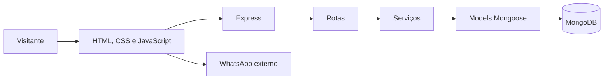

# Arquitetura

## Visão geral

Uma única aplicação Express serve arquivos estáticos e API JSON na mesma origem. O navegador monta os cards e abre links do WhatsApp; não envia compras ao servidor.

## Estrutura e responsabilidades

| Arquivo ou pasta | Responsabilidade |
| --- | --- |
| `server.js` | dotenv, middlewares, rotas, arquivos estáticos e inicialização |
| `public/index.html` | Conteúdo institucional, seções, elementos acessíveis e sprite SVG |
| `public/css/style.css` | Identidade visual, cards e responsividade |
| `public/js/app.js` | Consumo da API, montagem do DOM e links de contato |
| `src/config/db.js` | Conexão com MongoDB via Mongoose |
| `src/config/auth.mjs` | Better Auth em ESM, adaptador MongoDB e configuração de sessão |
| `src/routes/admin.js` | Autorização, validação e CRUD administrativo |
| `src/scripts/create-admin.mjs` | Provisionamento e recuperação de senha pelo terminal |
| `public/admin/` | Tela de login e painel administrativo |
| `test/admin.test.cjs` | Teste de integração com base temporária |
| `src/models/Animal.js` | Schema de animais e enum de status |
| `src/models/Depoimento.js` | Schema de depoimentos e autorização |
| `src/routes/animais.js` | Listagem e consulta por identificador |
| `src/routes/depoimentos.js` | Listagem de depoimentos |
| `src/services/animalService.js` | Regra de disponibilidade |
| `src/services/depoimentoService.js` | Regra de autorização |
| `src/seed/seed.js` | Substituição da base por dados demonstrativos |
| `.env.example` | Modelo de configuração sem credenciais reais |
| `package-lock.json` | Versões resolvidas das dependências |
| `docs/` | Documentação técnica e operacional |

`public/img` é opcional e não contém fotos no projeto inicial.

## Inicialização

O servidor carrega a configuração e registra Helmet, parser JSON, rate limit, rotas e tratamento de erros. Só abre a porta HTTP depois de conectar ao MongoDB. Em falha de conexão, termina com código 1. Não existe procedimento próprio de desligamento gracioso.

Rotas cuidam de HTTP e validação do identificador; serviços aplicam filtros; models definem dados. Consultas usam `lean()` e ordenam listagens por `createdAt` decrescente, sem critério secundário para empates. Better Auth é carregado como módulo ESM após conectar ao banco; seu handler é registrado antes do parser JSON, preservando o stream original.

## Interface

O JavaScript está isolado em uma função autoexecutável. Busca primeiro `/api/config`, configura os contatos e então carrega animais e depoimentos. Os detalhes ficam nos cards; não há tela ou modal separado para o endpoint individual.

Textos do banco são inseridos via `textContent`. Imagens dos cards usam carregamento preguiçoso e fallback para ícone quando falham. Catálogo vazio mostra convite de contato; falha da API mostra mensagem. Sem depoimentos ou em falha dessa API, a seção é ocultada.

O menu mobile alterna classes e `aria-expanded`. Há elementos semânticos, rótulos e textos alternativos, sem auditoria formal de acessibilidade. O CSS define cores em `:root`, adapta layout em 960px e 760px e considera movimento reduzido. A fonte Nunito vem do Google Fonts, com alternativas locais.

## Proteções e limites

- `X-Powered-By` desabilitado e cabeçalhos do Helmet.
- CSP permite scripts e conexões da própria origem; Google Fonts nos domínios configurados; imagens da própria origem, `data:` e HTTPS.
- Limite de 120 requisições por minuto por IP em `/api`, com armazenamento em memória por processo.
- Identificador validado antes da consulta individual.
- Erros internos retornam mensagem genérica e são registrados no console.
- Links de WhatsApp usam `noopener noreferrer`.

O painel usa Better Auth, sessão no MongoDB e cookies HttpOnly. Cada operação administrativa verifica a sessão e o e-mail autorizado no servidor, com proteção de origem e header próprio nas escritas. Veja [Administração](ADMINISTRACAO.md). Não há paginação, upload ou cache de aplicação. As consultas públicas retornam documentos completos do catálogo, inclusive metadados: não armazene dados privados nessas coleções.

A vitrine não tem formulários de visitantes ou analytics; o painel usa formulários e cookies de autenticação do administrador. Hospedagem pode registrar acessos; fontes, imagens remotas e WhatsApp envolvem terceiros. A flag de autorização de depoimentos controla exibição, mas não coleta nem comprova consentimento.
